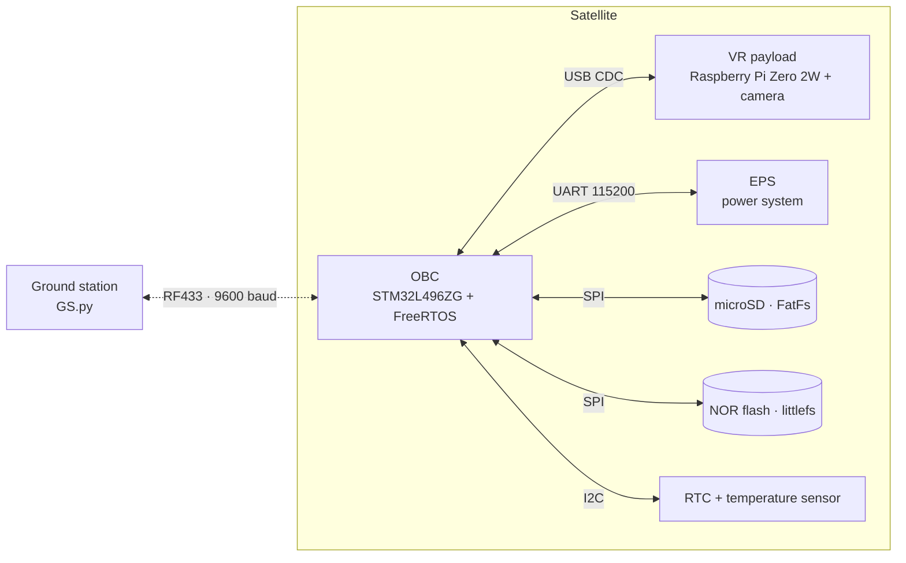

# SpaceFruit OBC

Flight software and ground tools for a CubeSat-style **On-Board Computer (OBC)**. It is built on an STM32L496ZG running FreeRTOS. The OBC talks to a ground station over a half-duplex RF433 radio link, controls a Raspberry Pi camera payload over USB, and polls the Electrical Power System (EPS) over UART.

> **Educational repository.** This project is shared publicly as a learning reference for small-satellite on-board software: RTOS task design, framed serial protocols over slow radio links, file downlink with resume, and flash file systems on microcontrollers. It is provided as-is and is not flight-qualified.

## Features

- **FreeRTOS firmware** with six tasks and event-flag state machines (STM32L496ZG at 80 MHz)
- **Custom layered protocol:** KISS framing, routing header and CRC-32 (computed by STM32 hardware), with a separate PID range for dangerous commands
- **Telemetry beacon** every 10 s: EPS voltages, currents and temperatures, RTC time, board temperature
- **File downlink with windows and resume** from the SD card. Interrupted downloads continue where they stopped.
- **Camera payload control:** capture, copy the image to the OBC over USB, health status, remote shutdown
- **Storage:** FatFs on microSD for mission files, littlefs on NOR flash for data that must survive power loss
- **Watchdog:** a dedicated task refreshes the IWDG, and the long downlink transmit is kept within its timeout
- **Python ground station, OBC emulator, traffic sniffer, and resume stress tests**, so the protocol can be tried with no hardware
- **MISRA C static analysis** (cppcheck) in GitHub Actions

## System overview



All three links use KISS framing. The full system description is in [docs/architecture.md](docs/architecture.md).

## Documentation

| Document | Contents |
| :--- | :--- |
| [Architecture](docs/architecture.md) | Block diagram, what each part does, mission flow, design decisions |
| [Firmware](docs/firmware.md) | Hardware interfaces and pins, RTOS tasks and synchronisation, state machine, storage, timing, **build and flash** |
| [Communication protocol](docs/protocol.md) | Frame format, CRC, every command and reply, beacon layout, sequence diagrams, internal Pi and EPS links |
| [Ground station and test tools](docs/ground-station-tools.md) | `GS.py` CLI, OBC emulator, sniffer, resume stress tests, running without hardware |
| [VR payload and EPS simulator](docs/payload-and-eps.md) | Raspberry Pi payload software and setup, EPS simulator |
| [Known limitations](docs/known-limitations.md) | Known issues and hard-coded values |

## Repository structure

```text
OBC_SpaceFruit/
├── Core/                        # Application firmware
│   ├── Inc/                     #   main.h, FreeRTOSConfig.h, commu_helper.h (ground-station frames)
│   └── Src/                     #   main.c: peripheral setup and all RTOS tasks
├── FATFS/                       # FatFs glue and the SPI SD-card driver
├── USB_DEVICE/                  # USB CDC (virtual COM port) device glue
├── Drivers/                     # ST HAL and CMSIS (vendor)
├── Middlewares/                 # FreeRTOS, FatFs, ST USB device library (vendor)
├── obc-drivers/                 # submodule: NOR flash, RTC, temperature sensor, littlefs port, KISS utils
├── obc-protocols/               # submodule: KISS, payload and EPS protocol encoders, hardware CRC
├── littlefs/                    # submodule: littlefs v2.11.2
├── Shared/Python/               # KISS + CRC and beacon decoder shared by the Python tools
├── eps_and_payload_emulator/
│   ├── kiss_file_transfer/      # Raspberry Pi payload service (vr.py) and transfer experiments
│   └── OBC_EPS_Script/          # EPS simulator (eps.py)
├── docs/                        # Detailed documentation
├── .github/workflows/           # MISRA C static analysis (cppcheck)
├── GS.py                        # Ground-station CLI
├── OBC.py                       # OBC emulator (no hardware needed)
├── Sniffer.py                   # Receive-only traffic decoder
├── test_gs_cli.py               # Smoke test of all GS commands
├── test_resume_downlink.py      # Download-resume stress test
├── multiple_test_downlink.py    # Repeats the stress test with random kill intervals
├── visualize_results.py         # Plots stress-test results
├── check.py                     # Byte-by-byte image comparison
├── hardware-test.ioc            # STM32CubeMX project (pins, clocks, middleware)
├── Makefile                     # Firmware build (arm-none-eabi-gcc)
├── STM32L496XX_FLASH.ld         # Linker script
├── startup_stm32l496xx.s        # Startup code
├── program.sh / program.bat     # Build and flash with OpenOCD + ST-Link
├── check_flash.sh               # Build and print flash/RAM usage
├── unison_sync.sh               # Sync payload code to the Raspberry Pi
└── requirements.txt             # Python dependencies for the PC tools
```

`downloads/`, `sd_card/` and `pi_files/` are created at runtime by `GS.py` and `OBC.py`. They are not part of the source.

## Quick start

### Try the protocol without hardware

You need Python 3 and a virtual serial port pair: [com0com](https://com0com.sourceforge.net/) on Windows, or `socat` on Linux/macOS. The example below assumes the pair `COM4` ↔ `COM5`.

```bash
pip install -r requirements.txt

# Terminal 1: emulated OBC that also sends beacons
python OBC.py --port COM5 --beacon

# Terminal 2: ground station
python GS.py --port COM4
GS> ping obc
GS> list
GS> download <file in sd_card/>
```

Run every script from the repository root. More details are in [docs/ground-station-tools.md](docs/ground-station-tools.md).

### Build and flash the firmware

You need the Arm GNU Toolchain (`arm-none-eabi-gcc`), `make`, OpenOCD and an ST-Link.

```bash
git clone --recurse-submodules <this-repo-url>
cd OBC_SpaceFruit
make              # builds build/hardware-test.elf
./program.sh      # builds, flashes over ST-Link, prints memory usage (program.bat on Windows)
```

The debug log is on `UART5` at 230400 baud. See [docs/firmware.md](docs/firmware.md#building-and-flashing) for the submodule SSH/HTTPS note and other details.

## Ground-station commands

| Command | Action |
| :--- | :--- |
| `ping obc` / `ping vr` | Check that the OBC / payload answers, and show the round-trip time |
| `list` | List files on the OBC's SD card |
| `info <file>` | File size and creation time |
| `download <file>` | Download a file in windows. Run the same command again to resume. |
| `status` | OBC boot count, link status, Pi CPU, RAM, disk, uptime and camera state |
| `capture` | Take a photo on the payload |
| `copy` | Copy the latest photo from the Pi to the OBC's SD card (as `0.jpg`) |
| `shutdown` | Shut down the Raspberry Pi safely |

The wire format of each command is in [docs/protocol.md](docs/protocol.md).

## Technology

| Area | Used |
| :--- | :--- |
| MCU | STM32L496ZG (Cortex-M4F, 1 MB flash, 320 KB SRAM) |
| RTOS | FreeRTOS (CMSIS-RTOS v2), `heap_4` |
| Libraries | STM32 HAL, FatFs, littlefs, ST USB device (CDC) |
| Peripherals | RF433 radio module, MT25QL NOR flash, RV-3028-C7 RTC, TMP1075 temperature sensor, microSD |
| Payload | Raspberry Pi Zero 2W, `fswebcam`, Python 3 |
| PC tools | Python 3, pyserial, pandas, matplotlib |
| Tooling | GNU Arm toolchain, Make, OpenOCD, STM32CubeMX, cppcheck (MISRA C) |

## License

Released under the [GNU General Public License v3.0](LICENSE). Vendor code under `Drivers/` and `Middlewares/`, and the `littlefs` submodule, keep their own licenses (see the license files in those folders).
