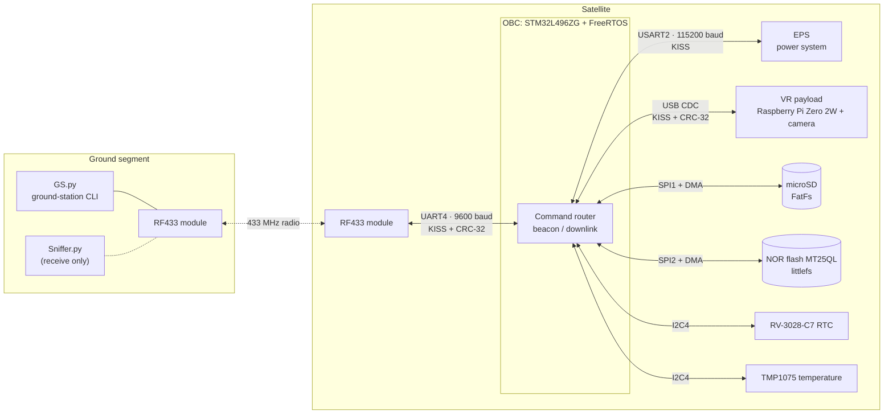

# System Architecture

SpaceFruit is a CubeSat-style system built around an **On-Board Computer (OBC)**. The OBC sits between the ground station and every other subsystem. It routes commands, collects telemetry, stores files, and sends them down over a slow, half-duplex radio link.

## Block diagram

## Who does what

| Part | Role |
| :--- | :--- |
| **Ground station** ([`GS.py`](../GS.py)) | Interactive command line. Builds request frames, decodes replies and beacons, downloads files with automatic windowing and resume. |
| **RF433 modules** | Transparent half-duplex serial radio. They carry bytes only and know nothing about the protocol. |
| **OBC firmware** ([firmware.md](firmware.md)) | Routes each request by `PayloadID` to itself or to the payload. Sends a beacon every 10 s. Serves files from the SD card. Polls the EPS and sensors. Keeps a boot counter in NOR flash. Recovers from hangs with a watchdog. |
| **EPS** | Power board. The OBC polls all of its telemetry (input and output V/I, switch states, battery temperatures) once per second and adds it to the beacon. |
| **VR payload** ([payload-and-eps.md](payload-and-eps.md)) | Raspberry Pi Zero 2W running `vr.py`. Takes photos with `fswebcam`, reports its health, and streams images to the OBC over USB. Can be shut down from the ground. |
| **microSD card** | Mission data, mainly images copied from the payload, waiting to be downlinked. |
| **NOR flash** | Small persistent values that must survive resets and power loss. Currently only the boot counter. |

## Typical mission flow

1. **Monitor:** the ground station receives a 121-byte beacon every 10 s with EPS power data, RTC time and board temperature.
2. **Check health:** `status` returns the OBC boot count together with the Pi's uptime, CPU, RAM, disk and camera state.
3. **Take a picture:** `capture` has the Pi take a photo.
4. **Move it to the OBC:** `copy` has the Pi send the image over USB. The OBC writes it to the SD card as `0.jpg`.
5. **Bring it down:** `download 0.jpg` pulls the file over the radio in 350-byte chunks, 5 chunks per request. An interrupted download resumes where it stopped.
6. **Power down the payload:** `shutdown` turns off the Pi safely before power is cut.

The message-level details of each step are in [protocol.md](protocol.md#6-sequence-diagrams).

## Design decisions

These choices shaped the project and are worth knowing before you change it.

- **KISS framing on every link.** KISS is easy to write on a microcontroller, recovers from lost bytes by itself (the receiver resyncs on the next `0xC0`), and is a common amateur-radio standard. One framing library serves all three links.
- **A routing header inside KISS.** `PayloadID` tells the OBC whether to handle a request itself or pass it to the payload. The OBC doesn't need to understand payload commands to forward them.
- **A separate PID range for dangerous commands.** Irreversible actions (`0x90`–`0xFF`) are kept away from everyday commands, so one flipped bit is unlikely to shut something down.
- **Hardware CRC-32.** The STM32 CRC unit computes CRC-32/MPEG-2, and the Python tools use the same algorithm in software. Corrupted frames are dropped without any reply.
- **The ground station drives each download window.** The OBC sends at most 5 chunks per request and then waits. The ground station tracks the offset, so a lost frame or a restarted ground station only means asking again from the last good offset. The OBC keeps no download state between windows.
- **An event-flag state machine instead of blocking calls.** The tasks share state through FreeRTOS event flags (`systemStateFlag`, `payloadFlag`). A slow payload or EPS can't freeze the radio link.
- **Watchdog as the last line of defence.** A dedicated high-priority task refreshes the IWDG (≈ 480 ms). Every long blocking operation, such as the downlink UART transmit, is limited to less than that timeout.
- **Logging through a queue.** `printf` drops characters into a queue and a separate task sends them out of `UART5`. The task calling `printf` never waits for the UART.
