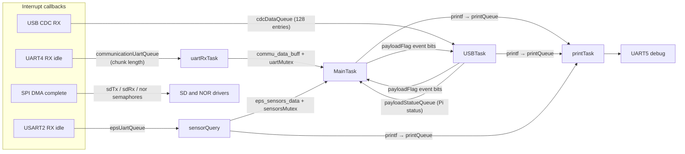
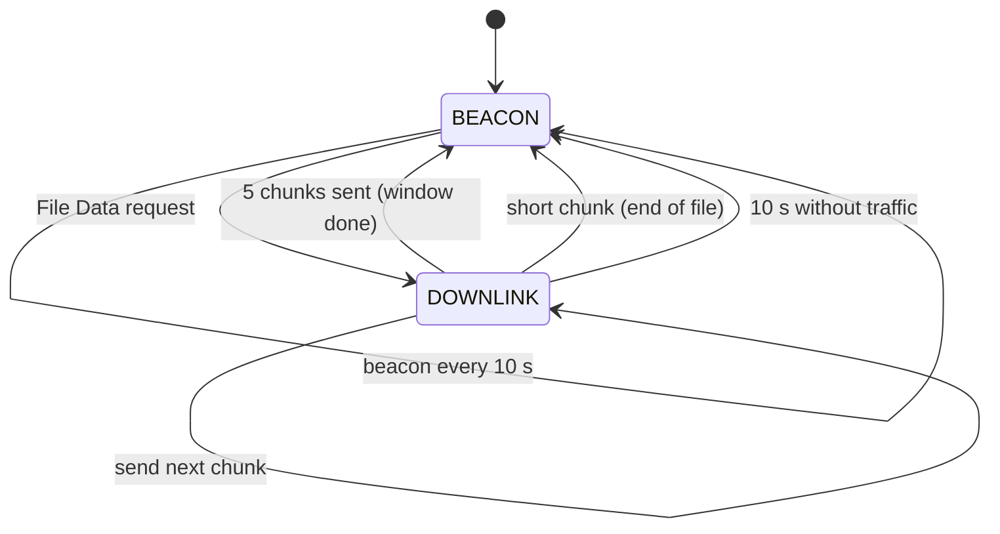

# OBC Firmware

The flight software runs on an **STM32L496ZG** (Arm Cortex-M4F, 1 MB flash, 320 KB SRAM) at **80 MHz** under **FreeRTOS** (CMSIS-RTOS v2 API). The project was generated with STM32CubeMX (`hardware-test.ioc`, STM32Cube FW_L4 V1.18.2) and builds with a plain Makefile and the GNU Arm toolchain.

Nearly all application logic is in [`Core/Src/main.c`](../Core/Src/main.c). The code that builds and parses ground-station frames is in [`Core/Inc/commu_helper.h`](../Core/Inc/commu_helper.h). Reusable drivers and protocol encoders come from two git submodules, `obc-drivers` and `obc-protocols`.

- [Hardware interfaces](#hardware-interfaces)
- [RTOS design](#rtos-design)
- [Main loop and system states](#main-loop-and-system-states)
- [Storage](#storage)
- [Timing constants](#timing-constants)
- [Building and flashing](#building-and-flashing)
- [Code map](#code-map)

---

## Hardware interfaces

| Peripheral | Settings | Connected to | Alias in `main.c` |
| :--- | :--- | :--- | :--- |
| `UART4` | 9600 baud, receive-to-idle interrupt | RF433 radio → ground station | `COM_UART` |
| `USART2` | 115200 baud, receive-to-idle interrupt | Electrical Power System (EPS) | `EPS_UART` |
| `UART5` | 230400 baud, blocking transmit | Debug console (`printf`) | `DBG_UART` |
| `USB_OTG_FS` | USB device, CDC class | VR payload (Raspberry Pi Zero 2W) | – |
| `SPI1` | 20 Mbit/s, DMA | microSD card (FatFs) | `SD_SPI` |
| `SPI2` | 40 Mbit/s, DMA | MT25QL NOR flash (littlefs) | `NOR_SPI` |
| `I2C4` | – | RV-3028-C7 RTC (`0x52`), TMP1075 temperature sensor (`0x48`) | – |
| `RTC` (internal) | Calendar, clocked from LSI | Set from the RV-3028-C7 every second; supplies FatFs file timestamps | – |
| `IWDG` | LSI / 128, reload 120 (≈ 480 ms) | Independent watchdog | – |
| `CRC` | Hardware CRC-32 | Frame checksums | – |
| `USART1`, `USART3` | 115200 baud | Set up but not used | – |
| `CAN2` | Set up, `HAL_CAN_Start` commented out | Not used | – |

GPIO pins named in [`main.h`](../Core/Inc/main.h):

| Signal | Pin | Use |
| :--- | :--- | :--- |
| `SD_SCK` / `SD_MISO` / `SD_MOSI` / `SD_CS` | PG2 / PG3 / PG4 / PG5 | SD card SPI |
| `SD_MUX` | PB15 | Output, driven low at startup |
| `NOR_RST` / `NOR_SCK` / `NOR_MISO` / `NOR_MOSI` / `NOR_CS` | PD0 / PD1 / PD3 / PD4 / PD5 | NOR flash SPI |
| `TEMP_ALERT` | PF13 | TMP1075 alert, rising-edge interrupt |
| `RTC_INT` | PG0 | RTC interrupt, rising-edge interrupt |

---

## RTOS design

### Tasks

| Task (function) | Priority | Stack | What it does |
| :--- | :--- | :--- | :--- |
| `MainTask` (`mainTask`) | Normal | 32 KB | Startup (USB, NOR flash, littlefs boot counter, RTC), then the main loop: beacon, file downlink, ground-station command handling |
| `USBTask` (`usbTask`) | Realtime | 16 KB | USB CDC link to the Pi: rebuilds KISS frames, handles ping/status/ACK replies, writes incoming image chunks to the SD card |
| `wdtFeed` (`wdtFeedTask`) | Realtime | 512 B | Refreshes the watchdog every 400 ms |
| `sensorQuery` (`sensorQueryTask`) | Normal | 2 KB | Reads the TMP1075 and polls the EPS (`GET_ALL`) once per second |
| `printTask` (`logTask`) | AboveNormal | 1 KB | Sends queued `printf` characters out of `UART5` |
| `uartRxTask` (`uartRx`) | AboveNormal7 | 2 KB | Rebuilds uplink KISS frames from `UART4` chunks and passes complete frames to `MainTask` |

FreeRTOS uses `heap_4` with a 64,000-byte heap and a 1 kHz tick. `TIM1` serves as the HAL timebase, leaving SysTick for the RTOS.

### Inter-task communication



| Object | Kind | Purpose |
| :--- | :--- | :--- |
| `systemStateFlag` | Event flags | OBC mode: `BEACON`, `DOWNLINK`, `WAIT_ACK` |
| `payloadFlag` | Event flags | Payload link state: `IDLE`, `PING`, `REQUEST_STATUS`, `POLL_CAPTURE`, `IMAGE_REQUEST`, `IMAGE_TRANSFER`, and their response bits |
| `uartMutex` | Mutex | Guards the uplink frame handed from `uartRxTask` to `MainTask` |
| `sensorsMutex` | Mutex | Guards the shared OBC and EPS sensor data |
| `cdcDataQueue` | Queue | Raw USB packets from the CDC receive callback |
| `communicationUartQueue` / `epsUartQueue` | Queues | Byte counts from the UART receive-to-idle callbacks |
| `payloadStatueQueue` | Queue | The Pi's 20-byte status reply, passed from `USBTask` to `MainTask` |
| `printQueue` | Queue | Characters from `printf`, so logging never blocks a task on the UART |
| `sdTx` / `sdRx` / `norFlash` semaphores | Binary semaphores | Signal SPI DMA completion to the storage drivers |

---

## Main loop and system states

`MainTask` runs a loop with no delay. On each pass it checks timers and event flags:

1. **Every 1 s:** log the OBC and payload states, read the RV-3028-C7 RTC and copy its time into the STM32's internal RTC, and copy the latest sensor and EPS data out under `sensorsMutex`. If new EPS data has arrived, pack it for the beacon.
2. **In `DOWNLINK` state:** read one chunk from the SD card and send it as a File Data frame. After 5 frames, or at end of file, switch back to `BEACON`.
3. **No downlink traffic for 10 s:** reset to `BEACON` and clear the downlink counter.
4. **In `BEACON` state, every 10 s:** send a beacon.
5. **When `uartRxTask` has a complete frame:** decode it, check its CRC, and dispatch it by PayloadID and PID.
6. **When `payloadFlag` changes from `IMAGE_TRANSFER` to `IDLE`:** send the "copy finished" reply to the ground station.



The `WAIT_ACK` bit still exists in the code but nothing sets it any more. An earlier design waited for an ACK from the ground station; the current design has the ground station request each window.

---

## Storage

| Medium | Bus | File system | Contents |
| :--- | :--- | :--- | :--- |
| microSD card | `SPI1` + DMA | FatFs | Files served to the ground station (list, info, data). Images copied from the Pi are written to `0.jpg` in the root folder and replace the previous copy. |
| MT25QL NOR flash | `SPI2` + DMA | littlefs v2.11.2 | A `boot_count` file. It is incremented on every boot and reported in System Status. |

Files written to the SD card get their FAT date and time from the STM32's internal RTC, through `get_fattime()` in [`FATFS/App/fatfs.c`](../FATFS/App/fatfs.c). The main loop sets that RTC from the RV-3028-C7 every second.

littlefs suits raw NOR flash because it survives power loss and spreads writes across the chip. If mounting fails (first boot, or a corrupted file system), the firmware formats the flash and mounts it again.

The FatFs layer uses a custom SPI SD-card driver in [`FATFS/Target/`](../FATFS/Target/) (`sd_spi.c`, `sd_diskio_spi.c`, `sd_functions.c`), plus an optional read/write benchmark in `sd_benchmark.c`.

---

## Timing constants

All values are defined at the top of `main.c` unless noted otherwise.

| Constant | Value | Meaning |
| :--- | :--- | :--- |
| `DATA_POLLING_INTERVAL` | 1000 ms | Status log and sensor snapshot interval |
| `BEACON_INTERVAL` | 10000 ms | Beacon period |
| `NO_COMMU_TIMEOUT` | 10000 ms | Return to `BEACON` after this long without downlink traffic |
| `DOWNLINK_WINDOW_SIZE` | 5 | File Data frames sent per request |
| `COMMU_RX_TIMEOUT` | 3000 ms | Discard a half-received uplink frame |
| `PAYLOAD_RX_TIMEOUT` | 3000 ms | Discard a half-received USB frame and reset the payload state |
| Payload reply wait | 1000 ms | How long to wait for the Pi's ping, status or image ACK |
| `EPS_WAIT_TIMTOUT` | 300 ms | EPS reply timeout (in `eps_protocol.h`) |
| Watchdog | ≈ 480 ms | IWDG timeout; `wdtFeed` refreshes every 400 ms |
| Downlink UART transmit | 400 ms | Blocking transmit timeout. Must stay below the watchdog timeout. |

---

## Building and flashing

### Prerequisites

- [Arm GNU Toolchain](https://developer.arm.com/downloads/-/arm-gnu-toolchain-downloads) (`arm-none-eabi-gcc`) on your `PATH`, or pass `GCC_PATH=...` to `make`
- GNU `make`
- [OpenOCD](https://openocd.org/) and an ST-Link probe, for flashing
- STM32CubeMX (optional), to view or regenerate the pin and clock setup in `hardware-test.ioc`

### Get the source with submodules

```bash
git clone --recurse-submodules <this-repo-url>
# or, inside an existing clone:
git submodule update --init --recursive
```

`obc-drivers` and `obc-protocols` use SSH URLs (`git@github.com:...`). If you don't have SSH keys set up for GitHub, have git use HTTPS instead:

```bash
git config --global url."https://github.com/".insteadOf "git@github.com:"
```

### Build

```bash
make            # output: build/hardware-test.elf (.hex and .bin too)
```

The Makefile builds a debug image by default (`DEBUG = 1`, `-Og`) for `-mcpu=cortex-m4 -mfpu=fpv4-sp-d16 -mfloat-abi=hard`.

### Flash

| Script | What it does |
| :--- | :--- |
| [`program.sh`](../program.sh) | `make`, flash and verify with OpenOCD (`interface/stlink.cfg`, `target/stm32l4x.cfg`), reset, then print flash/RAM usage |
| [`program.bat`](../program.bat) | Same, for Windows `cmd` |
| [`check_flash.sh`](../check_flash.sh) | `make` and print flash/RAM usage only, without flashing |

### Watching the firmware run

Connect a USB-UART adapter to `UART5` at **230400 baud** to see the debug log: boot messages, the littlefs boot count, the system and payload state every second, and a hex dump of each uplink frame.

### Static analysis (CI)

[`.github/workflows/codeql.yml`](../.github/workflows/codeql.yml) runs on every push to `dev`. It runs **cppcheck with the MISRA C addon** on `Core/Src`, `obc-drivers` and `obc-protocols`, converts the report to SARIF, and uploads it to the GitHub Security tab. The ST HAL and other vendor code are not checked.

---

## Code map

| Path | Contents |
| :--- | :--- |
| `Core/Src/main.c` | Peripheral setup, all six RTOS tasks, UART/SPI callbacks, `EPS_Perform_Transaction()` |
| `Core/Inc/commu_helper.h` | Ground-station frame header, PID enums, `commu_encode()` / `commu_decode()`, file request/reply encoders |
| `Core/Inc/FreeRTOSConfig.h` | FreeRTOS settings (`Core/Src/freertos.c` is an empty CubeMX stub) |
| `FATFS/` | FatFs glue and the SPI SD-card driver |
| `USB_DEVICE/` | USB CDC device setup and descriptors; `usbd_cdc_if.c` pushes received packets into `cdcDataQueue` |
| `obc-drivers/` (submodule) | `mt25ql_dma.c` (NOR flash), `littlefs_port.c`, `rv3028c7.c` (RTC), `tmp1075.c`, `lm75.c`, `kiss_utils.c` (KISS + payload frames), `hal_stm32.c` |
| `obc-protocols/` (submodule) | `kiss_protocol.c`, `payload_protocol.c` (OBC ↔ Pi), `eps_protocol.c` (OBC ↔ EPS), `protocol_utils.c` (hardware CRC-32) |
| `littlefs/` (submodule) | Upstream littlefs v2.11.2 |
| `Drivers/`, `Middlewares/` | ST HAL, CMSIS, FreeRTOS, FatFs and the ST USB device library (vendor code) |
| `STM32L496XX_FLASH.ld`, `startup_stm32l496xx.s` | Linker script and startup code |
