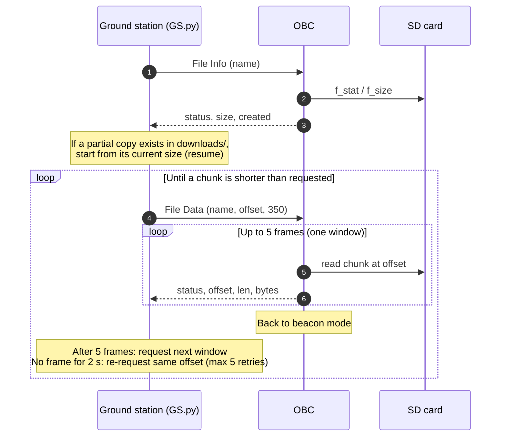
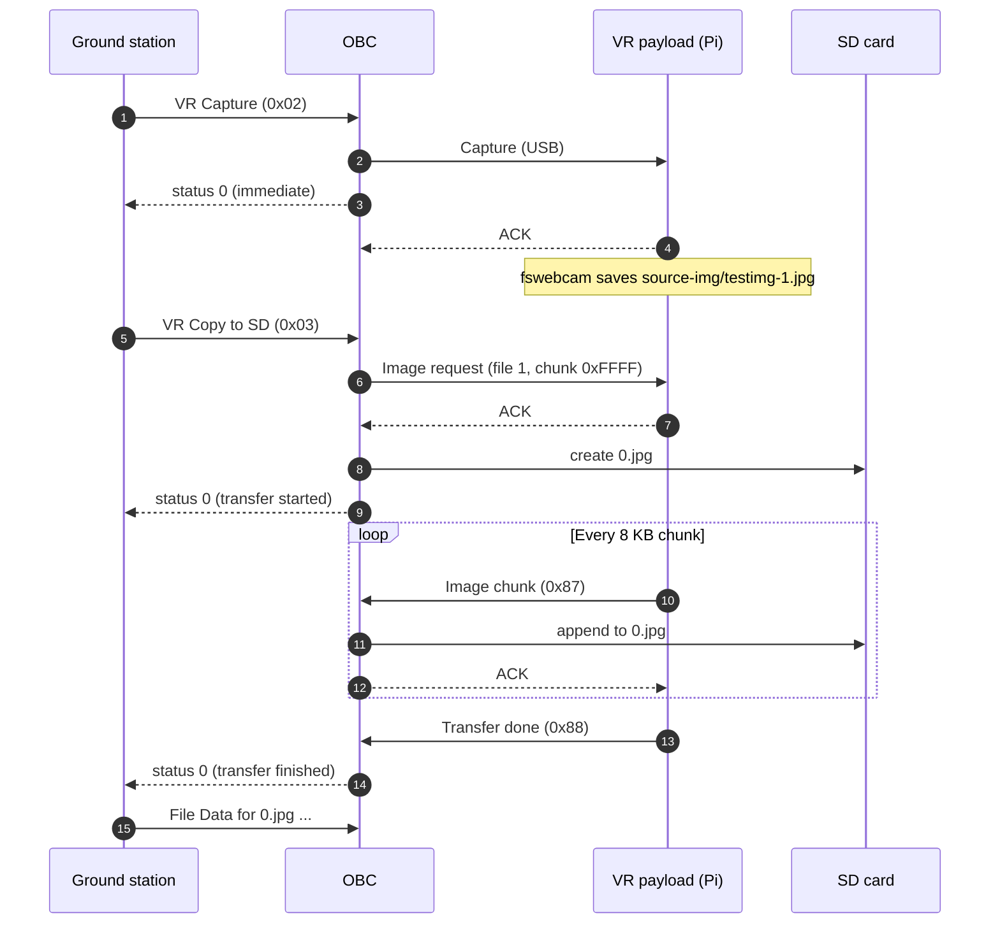

# Communication Protocol

The OBC talks to three other parties over serial links. All three links use KISS framing, but each puts a different header inside the frame.

| Link | Physical layer | Inner header | Integrity check |
| :--- | :--- | :--- | :--- |
| Ground station ↔ OBC | RF433 half-duplex radio on `UART4`, 9600 baud 8N1 | SeqNum, PayloadID, PID, DataLen | CRC-32 |
| OBC ↔ VR payload (Raspberry Pi) | USB CDC virtual COM port | PayloadID, PID, DataLen (no SeqNum) | CRC-32 |
| OBC ↔ EPS | `USART2`, 115200 baud 8N1 | One command byte | None |

Most of this page covers the ground-station link, since that is the link you use to operate the satellite. The two internal links are described at the end.

- [1. Ground station ↔ OBC frame](#1-ground-station--obc-frame)
- [2. Command summary](#2-command-summary)
- [3. OBC commands (PayloadID 0x00)](#3-obc-commands-payloadid-0x00)
- [4. VR payload commands (PayloadID 0x01)](#4-vr-payload-commands-payloadid-0x01)
- [5. Beacon](#5-beacon)
- [6. Sequence diagrams](#6-sequence-diagrams)
- [7. OBC ↔ VR payload link](#7-obc--vr-payload-link)
- [8. OBC ↔ EPS link](#8-obc--eps-link)
- [9. Python `struct` cheat sheet](#9-python-struct-cheat-sheet)

---

## 1. Ground station ↔ OBC frame

```
┌──────┬─────────┬────────┬───────────┬─────┬─────────┬──────────┬───────┬──────┐
│ FEND │ Command │ SeqNum │ PayloadID │ PID │ DataLen │   Data   │ CRC32 │ FEND │
│ 0xC0 │   1 B   │  1 B   │    1 B    │ 1 B │   2 B   │ DataLen  │  4 B  │ 0xC0 │
└──────┴─────────┴────────┴───────────┴─────┴─────────┴──────────┴───────┴──────┘
 └─ KISS ──────┘ └──────────── routing header ───────┘ └─ app ──┘ └─ check ┘
```

- **Byte order:** every multi-byte integer is big-endian.
- **CRC32** covers `SeqNum` through the end of `Data`. It does not cover `FEND` or `Command`. It is computed on the unescaped bytes.
- **Escaping:** standard KISS escaping applies to everything between the two `FEND` bytes:

  | Byte in payload | Sent as |
  | :--- | :--- |
  | `0xC0` (FEND) | `0xDB 0xDC` |
  | `0xDB` (FESC) | `0xDB 0xDD` |

- **Smallest frame:** 9 bytes between the FENDs (header + CRC, no data).

### Field definitions

**Command** gives the direction of the frame, so a receiver can tell requests from responses without reading the payload. This is the field that standard KISS uses for port and command.

| Value | Meaning |
| :--- | :--- |
| `0x00` | Request frame (GS → OBC) |
| `0x01` | Data / response frame (OBC → GS) |

**SeqNum** is an 8-bit counter. The ground station always sends `0`. The OBC uses it as a running chunk counter on File Data frames. On the Shutdown reply it echoes the request's value. Every other frame carries `0`.

**PayloadID** selects the subsystem that handles the frame.

| Value | Subsystem |
| :--- | :--- |
| `0x00` | OBC itself (SD card, sensors, beacon, system status) |
| `0x01` | VR payload (Raspberry Pi Zero 2W behind the OBC) |

**PID** is the action inside that subsystem.

| Range / value | Meaning |
| :--- | :--- |
| `0x00`–`0x8F` | Normal commands |
| `0x90`–`0xFF` | Dangerous or irreversible commands, such as shutdown. Kept in a separate range so a corrupted byte is unlikely to trigger one by accident. |
| `0xAC` | ACK |
| `0xAD` | NAK |

**DataLen** is the length of `Data` in bytes, as a 16-bit value.

### Practical size limits

The 16-bit `DataLen` allows up to 65,535 bytes, but the firmware buffers are much smaller:

- **Uplink (GS → OBC):** the receive buffer holds 256 bytes and the decoded payload buffer holds 128 bytes. Keep request `Data` under 128 bytes. This also limits file names.
- **Downlink file chunks:** the OBC sends each chunk with a blocking UART transmit that has a 400 ms timeout, so the transmit finishes before the ~480 ms watchdog fires. At 9600 baud the link carries about 960 bytes per second, so one frame must stay under roughly 380 bytes on air. The ground station uses **350-byte** chunks.

### Example frames

These were generated with [`Shared/Python/kiss_protocol.py`](../Shared/Python/kiss_protocol.py) and can be used as test vectors.

| Frame | Bytes |
| :--- | :--- |
| Ping OBC (request) | `C0 00 00 00 00 00 00 47 10 BB 9C C0` |
| Ping OBC (response) | `C0 01 00 00 00 00 00 47 10 BB 9C C0` |
| File Info for `0.jpg` | `C0 00 00 00 02 00 06 05 30 2E 6A 70 67 28 4F 6C 62 C0` |
| File Data for `0.jpg`, offset 0, 350 B | `C0 00 00 00 03 00 0C 05 30 2E 6A 70 67 00 00 00 00 01 5E 38 4B 5D E3 C0` |

### CRC-32 parameters

The CRC is computed by the STM32 hardware CRC unit and reproduced in software by the Python tools. The variant is **CRC-32/MPEG-2**:

| Parameter | Value |
| :--- | :--- |
| Polynomial | `0x04C11DB7` |
| Initial value | `0xFFFFFFFF` |
| Reflect input / output | No / No |
| Final XOR | `0x00000000` |
| Check value (`"123456789"`) | `0x0376E6E7` |

This is **not** the usual zlib/Ethernet CRC-32, which uses reflected bits and a final XOR. `zlib.crc32()` gives a different result.

---

## 2. Command summary

### Requests from the ground station (Command `0x00`)

| PayloadID | PID | Name | Request data | Reply | `GS.py` command |
| :--- | :--- | :--- | :--- | :--- | :--- |
| `0x00` | `0x00` | Ping OBC | none | Empty frame, PID `0x00` | `ping obc` |
| `0x00` | `0x01` | List files | none | File list | `list` |
| `0x00` | `0x02` | File info | File name | 9 bytes | `info <file>` |
| `0x00` | `0x03` | File data | Name, offset, length | Up to 5 chunk frames | `download <file>` |
| `0x00` | `0x04` | *(reserved: used by the beacon on downlink)* | | | |
| `0x00` | `0x05` | System status | none | 26 bytes | `status` |
| `0x01` | `0x00` | Ping VR payload | none | Empty frame, PID `0x00`, or NAK `0xAD` | `ping vr` |
| `0x01` | `0x02` | Capture image | none | 2 bytes | `capture` |
| `0x01` | `0x03` | Copy image to SD | none | 1 byte, sent twice (start and finish) | `copy` |
| `0x01` | `0x90` | Shut down the Pi | none | Empty frame, PID `0x90` | `shutdown` |

### Frames the OBC sends on its own (Command `0x01`)

| PayloadID | PID | Name | Period |
| :--- | :--- | :--- | :--- |
| `0x00` | `0x04` | Beacon | Every 10 s while no file download is in progress |

### Defined but not used on this link

Some IDs show up in headers or older notes but have no handler in the firmware:

- **VR `0x01` (Pi Status) sent from the GS:** the OBC never replies. Pi status reaches the ground station only as part of OBC `0x05` System Status.
- **VR `0x04` (Check Copy):** no handler. The second Copy reply (see below) does this job instead.
- **ACK `0xAC` on the GS link:** the downlink has no ACK. The ground station asks for the next window with a new File Data request.

---

## 3. OBC commands (PayloadID `0x00`)

### Ping `0x00`

Request: no data. Reply: empty frame with the same PID. `GS.py` prints the round-trip time.

### List files `0x01`

Request: no data.

Reply:

| Number of files | Then, for each file: name length | Name (ASCII) |
| :--- | :--- | :--- |
| `uint8` | `uint8` | N bytes |

The OBC lists only the files in the root directory of the SD card, not folders. It can list at most 20 files, and the whole reply has to fit in 256 bytes. **The OBC does not reply** when the card is empty, when it cannot mount the card, or while an image copy from the payload is running.

### File info `0x02`

Request:

| Name length | Name (ASCII) |
| :--- | :--- |
| `uint8` | N bytes |

Reply (9 bytes):

| Status | File size | Created |
| :--- | :--- | :--- |
| `uint8` | `uint32` (bytes) | `uint32` Unix time, converted from the FAT date and time |

The OBC ignores this request while an image copy is running.

### File data `0x03`

Request:

| Name length | Name (ASCII) | Offset | Chunk length |
| :--- | :--- | :--- | :--- |
| `uint8` | N bytes | `uint32` | `uint16` |

The OBC replies with a **window of up to 5 frames**. Each frame carries the next chunk of the file:

| Status | Offset of this chunk | Bytes in this chunk | File bytes |
| :--- | :--- | :--- | :--- |
| `uint8` | `uint32` | `uint16` | N bytes |

- After each frame the offset moves forward by the number of bytes read.
- A chunk shorter than the requested length means end of file. The OBC stops early.
- After the window, the OBC goes back to beacon mode and waits for the ground station to request the next window.
- The OBC ignores this request while an image copy is running.

[Section 6](#6-sequence-diagrams) shows the whole download, including resume.

### System status `0x05`

Request: no data. Before replying, the OBC asks the Pi for its status over USB and waits up to 1 s.

Reply (26 bytes):

| Offset | Field | Type | Source |
| :--- | :--- | :--- | :--- |
| 0 | OBC boot count | `uint32` | `boot_count` file in littlefs on the NOR flash |
| 4 | USB / payload link | `uint8` | `0` = idle, `1` = busy |
| 5 | EPS status | `uint8` | Always `0` in this firmware |
| 6 | Pi boot count | `uint32` | Pi |
| 10 | Pi timestamp | `uint32` | Reserved, always `0` |
| 14 | Pi uptime | `uint32` | Seconds |
| 18 | Pi CPU load | `uint8` | Percent |
| 19 | Pi CPU temperature | `int32` | Milli-degrees C, from `/sys/class/thermal` |
| 23 | Pi RAM usage | `uint8` | Percent |
| 24 | Pi disk usage | `uint8` | See [known limitations](known-limitations.md) |
| 25 | Camera status | `uint8` | `0` = error, `1` = ready, `2` = busy |

The last 20 bytes are the Pi's status reply passed through unchanged ([section 7](#7-obc--vr-payload-link)).

---

## 4. VR payload commands (PayloadID `0x01`)

The OBC routes these commands to the Raspberry Pi over USB. Some replies come from the Pi; others the OBC sends right away.

### Ping `0x00`

The OBC forwards the ping to the Pi and waits up to 1 s.

- The Pi answered: empty frame, PID `0x00`.
- The Pi timed out, or the payload was busy: empty frame, PID `0xAD` (NAK).

### Capture `0x02`

The OBC forwards the request and **replies at once, without waiting for the camera**:

| Status | Name length | Name |
| :--- | :--- | :--- |
| `uint8` (`0`) | `uint8` (`0`) | empty |

On the Pi, `capturepicture.py` runs `fswebcam` (640×480, 20 warm-up frames skipped). The image is saved as `source-img/testimg-1.jpg`.

### Copy image to SD `0x03`

The Pi sends its latest image to the OBC, which writes it to the SD card as `0.jpg` and replaces any older copy.

1. The OBC asks the Pi for file 1, the whole file, and waits up to 1 s for an ACK.
2. **First reply** (1 byte): `0x00` means the transfer started. `0x01` means the Pi did not answer.
3. The image moves over USB in 8 KB chunks. Each chunk is acknowledged.
4. **Second reply** (1 byte, `0x00`): sent when the Pi reports the transfer is done.

While the copy runs, the OBC ignores List, Info and File Data requests. After it finishes, use `download 0.jpg` to bring the image down.

### Shutdown `0x90` (dangerous)

The OBC sends the shutdown command to the Pi without waiting for confirmation. It then replies to the ground station at once with an empty frame (PID `0x90`, same SeqNum as the request). The Pi sends an ACK and runs `sudo systemctl poweroff` about 2 s later. Nothing else comes back from the Pi.

---

## 5. Beacon

PayloadID `0x00`, PID `0x04`, Command `0x01`, SeqNum `0`. The OBC broadcasts a beacon every 10 s while it is in beacon mode, which is any time a file download is not in progress.

Full beacon, 121 bytes:

| Offset | Block | Size | Layout |
| :--- | :--- | :--- | :--- |
| 0 | EPS input V/I sensors | 48 B | 8 × `[voltage int16 mV][current int16 mA][channel u8][state u8]` |
| 48 | EPS output V/I sensors | 36 B | 6 × `[voltage int16 mV][current int16 mA][channel u8][state u8]` |
| 84 | EPS output switch states | 18 B | 6 × `[status u8][channel u8][state u8]` |
| 102 | EPS battery temperatures | 8 B | 2 × `[temperature int16, °C × 100][channel u8][state u8]` |
| 110 | RTC date and time | 7 B | BCD: `sec, min, hour, weekday, day, month, year` (year = 20YY) |
| 117 | OBC board temperature (TMP1075) | 4 B | `int32`, milli-degrees C |

Until the EPS has answered at least once, the OBC leaves out the four EPS blocks and the beacon is only **11 bytes** (RTC + temperature). `GS.py` and `Sniffer.py` decode only full 121-byte beacons; they report shorter ones as too short.

---

## 6. Sequence diagrams

### File download with windows and resume



Each window is driven by a new request, so the ground station can stop at any time and pick up later. If the link drops or `GS.py` is killed, run `download <file>` again: `GS.py` finds the partial file in `downloads/` and continues from where it stopped. [`test_resume_downlink.py`](../test_resume_downlink.py) tests this repeatedly.

### Image capture and copy



---

## 7. OBC ↔ VR payload link

The Pi connects to the OBC's USB port and sees it as a serial port: *Openfruit Aerospace OBC VCP*, VID `0xF055`, PID `0x0BC1`. The frame looks like the ground-station frame, but **without SeqNum**:

```
[FEND][Command][PayloadID][PID][DataLen 2B][Data][CRC32 4B][FEND]
```

The CRC covers `PayloadID` through `Data` and uses the same CRC-32/MPEG-2 settings.

Image chunks have their own layout:

```
[FEND][Command][0x01][0x87][FileID 1B][ChunkID 2B][ChunkLen 2B][Content][CRC32 4B][FEND]
```

| PID | Direction | Meaning |
| :--- | :--- | :--- |
| `0x00` | OBC → Pi, Pi → OBC | Ping and its reply |
| `0x01` | OBC → Pi, Pi → OBC | Status request and its 20-byte reply |
| `0x02` | OBC → Pi | Capture an image (the Pi sends an ACK) |
| `0x03` | OBC → Pi | Image request: `[file_id u8][chunk_id u16]`; `0xFFFF` = whole file (the Pi sends an ACK) |
| `0x87` | Pi → OBC | Image chunk (the OBC sends an ACK for each one) |
| `0x88` | Pi → OBC | Image transfer done |
| `0x90` | OBC → Pi | Shut down (the Pi sends an ACK, then powers off) |
| `0xAC` | both | ACK |

Pi status reply, 20 bytes, `struct` format `>IIIBIBBB`:

| Field | Type |
| :--- | :--- |
| Boot count | `uint32` |
| Timestamp (reserved, `0`) | `uint32` |
| Uptime (s) | `uint32` |
| CPU load (%) | `uint8` |
| CPU temperature (milli-°C) | `uint32` |
| RAM usage (%) | `uint8` |
| Disk usage | `uint8` |
| Camera status | `uint8` |

- **Chunk size:** 8192 bytes, set by `CHUNK_SIZE` in [`config.py`](../eps_and_payload_emulator/kiss_file_transfer/config.py).
- **File IDs:** file ID `n` maps to `source-img/testimg-n.jpg` (`n` = 0–3). The OBC always asks for file 1, which is where `capturepicture.py` saves the photo.

---

## 8. OBC ↔ EPS link

The EPS is on `USART2` at 115200 baud. Each command is one ID byte in a KISS frame (`0xC0 0x00 <cmd> [args] 0xC0`), with no CRC.

| ID | Command |
| :--- | :--- |
| `0x01` | Get input (solar/battery) V/I sensor |
| `0x02` | Get output V/I sensor |
| `0x03` | Get output switch state |
| `0x04` | Get battery temperature |
| `0x05` | Set output switch |
| `0x06` | Get all telemetry |

The OBC sends only `0x06`, once per second, and waits up to 300 ms for the reply. The reply is **little-endian**, 92 bytes:

| Block | Layout |
| :--- | :--- |
| 8 × input V/I | `[voltage int16][current int16][channel u8]` |
| 6 × output V/I | `[voltage int16][current int16][channel u8]` |
| 6 × switch state | `[status u8][channel u8]` |
| 2 × battery temperature | `[temperature float32][channel u8]` |

The OBC repacks this data into the big-endian, 110-byte EPS section of the [beacon](#5-beacon). [`eps.py`](../eps_and_payload_emulator/OBC_EPS_Script/eps.py) simulates the EPS side.

---

## 9. Python `struct` cheat sheet

| What | Format | Size |
| :--- | :--- | :--- |
| GS link header (SeqNum, PayloadID, PID, DataLen) | `>BBBH` | 5 |
| CRC32 | `>I` | 4 |
| File info reply | `>BII` | 9 |
| File data chunk header | `>BIH` | 7 |
| File data request tail (offset, length) | `>IH` | 6 |
| System status reply | `>IBBIIIBiBBB` | 26 |
| Pi status (internal) | `>IIIBIBBB` | 20 |
| Beacon V/I sensor | `>hhBB` | 6 |
| Beacon switch state | `>BBB` | 3 |
| Beacon battery temperature | `>hBB` | 4 |
| Beacon TMP1075 | `>i` | 4 |
